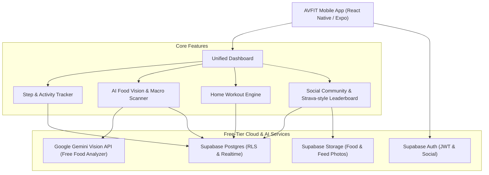

# AVFIT - All-in-One Fitness & Community Platform

[](https://opensource.org/licenses/MIT)
[-green.svg)](https://expo.dev)
[-emerald.svg)](https://supabase.com)
[-orange.svg)](https://ai.google.dev)

> **AVFIT: One app for the complete fitness journey.**  
> Built with the official high-velocity Electric Cyan & Satin Charcoal 'AV' kinetic blade monogram.

---

## 🎨 Official AVFIT Logo & App Icon Assets
- **Official App Icon**: [`assets/icon.png`](./assets/icon.png) & [`assets/avfit_official_logo.png`](./assets/avfit_official_logo.png)
- **Vector Logo Assets**: [`assets/avfit-logo.svg`](./assets/avfit-logo.svg) & [`assets/avfit-icon.svg`](./assets/avfit-icon.svg)
- **React Native Component**: [`src/components/common/AvfitLogo.tsx`](./src/components/common/AvfitLogo.tsx)
- **Brand Identity Showcase**: Open [`docs/avfit_brand_kit.html`](./docs/avfit_brand_kit.html) or [`docs/avfit_new_logos.html`](./docs/avfit_new_logos.html).

---

## 📱 App Highlights & Architecture



---

## 🌟 Core Pillars

1. **Unified Fitness Dashboard**
   - Centralized view of daily steps, burned calories, consumed calories, macronutrient balance (Carbs/Protein/Fat), active streak, and scheduled workouts.
   - Dynamic motivational prompts based on time of day and completed goals.

2. **Step & Activity Tracking**
   - Background pedometer integration using Google Health Connect / Android Sensors.
   - Strava-inspired social leaderboards (Weekly, Monthly, Friends-only).
   - Streak shields, milestone badges, and step challenges (e.g., "10k Daily Challenge").

3. **AI Food Scanner & Nutrition Calculator**
   - Snap a photo of any meal or snack.
   - Multimodal Vision AI detects dishes, estimates weights/portions, and calculates Calories, Protein, Carbs, Fats, and Fiber.
   - Quick one-tap corrections for portion sizes and ingredients.
   - Daily calorie and macro target progression bar.

4. **Personalized Diet & Nutrition Plans**
   - Onboarding calculator: BMR, TDEE, macronutrient ratios tuned to user goals (Fat Loss, Lean Bulk, Maintenance, Endurance).
   - Auto-generated meal recommendations adapting to dietary restrictions (Vegetarian, Vegan, Keto, High-Protein).

5. **Home Workouts & Smart Timers**
   - Curated bodyweight and minimal-equipment routines (Beginner to Advanced).
   - Built-in exercise coach: animated instructions, rep counter, and rest timer with audio cues.
   - Workout completion history and volume tracking.

6. **Fitness Community & Social Feed**
   - Share workout PRs, daily steps, and healthy recipes.
   - Photo sharing with privacy controls (Public, Friends, Only Me).
   - High-fives, comments, follows, and friendly head-to-head challenges.

---

## 🚀 Low-Cost / Zero-Budget Tech Stack (2-Developer MVP)

| Layer | Technology | Free Tier Advantage |
|---|---|---|
| **Mobile Client** | **React Native + Expo (TypeScript)** | 1 codebase for Android & iOS; instant test via Expo Go on physical phones without Mac. |
| **Styling & UI** | **NativeWind (Tailwind CSS) + Lucide Icons** | Fast rapid prototyping; consistent design tokens across screens. |
| **Backend & DB** | **Supabase (PostgreSQL)** | Free Tier: 50,000 MAU auth, 500MB database, 1GB storage, built-in Row-Level Security. |
| **AI Food Vision** | **Google Gemini 1.5 Flash API** | Generous free quota (15 RPM), structured JSON outputs for instant food & macro parsing. |
| **Activity Tracking** | `expo-sensors` (Pedometer) + Android Health Connect | Local sensor tracking with zero API costs. |

---

## 📂 Repository Directory Structure

```text
├── .github/
│   ├── ISSUE_TEMPLATE/
│   │   ├── bug_report.md
│   │   └── feature_request.md
│   └── workflows/
│       └── ci.yml
├── docs/
│   ├── PRD.md                     # Comprehensive Product Requirements Document
│   ├── ARCHITECTURE.md            # System Architecture & Tech Stack Evaluation
│   ├── UI_UX_SPEC.md              # Design System, Wireframes & Component Specs
│   ├── DATABASE_SCHEMA.sql        # Supabase PostgreSQL schema with RLS policies
│   ├── AI_NUTRITION_PIPELINE.md   # Gemini Vision prompt templates & JSON schemas
│   ├── ROADMAP_MVP.md             # 2-Developer Sprint Plan & Milestone Execution
│   └── prototype.html             # Interactive Wireframe & UI Visualizer (Open in browser)
├── src/
│   ├── api/                       # API clients (Supabase, Gemini Vision)
│   ├── components/                # Reusable UI components (Buttons, Cards, Rings)
│   ├── navigation/                # Bottom tabs and stack navigators
│   ├── screens/                   # Core screens (Dashboard, Scanner, Workouts, Community)
│   ├── hooks/                     # Custom hooks (useSteps, useNutrition, useAuth)
│   ├── types/                     # TypeScript definitions
│   └── utils/                     # Macro calculators, formatters, storage helpers
├── app.json                       # Expo configuration
├── package.json                   # Dependencies and scripts
└── tsconfig.json                  # TypeScript configuration
```

---

## 🎨 Interactive Wireframe & UI Prototype

We have built an interactive HTML/Tailwind wireframe visualizer that showcases both **Low-Fidelity Wireframes** and **High-Fidelity UI Mockups** for all 5 core screens:
- Open [`docs/prototype.html`](./docs/prototype.html) directly in any web browser to test interactive tab switching, live food scanning simulator, workout rest timers, and community posts!

---

## 🛠️ Quick Start (Developer Setup)

### Prerequisites
- Node.js (v18 or higher recommended)
- Git
- Expo Go App on your Android phone ([Google Play Store](https://play.google.com/store/apps/details?id=host.exp.exponent))

### Installation
```bash
# 1. Clone repository
git clone https://github.com/your-username/fitpulse.git
cd fitpulse

# 2. Install dependencies
npm install

# 3. Configure environment variables
cp .env.example .env
# Fill in your free Supabase URL and Google Gemini API Key

# 4. Start Expo development server
npx expo start
```

Scan the QR code with your phone camera or the Expo Go app to launch the app instantly on your Android device!

---

## 👥 Development Team & Collaboration
Designed and built by a lean 2-person development team:
- **Developer 1 (Frontend & UX Lead)**: UI/UX implementation, screen flows, Pedometer sensors, React Native navigation.
- **Developer 2 (Backend & AI Lead)**: Supabase database, authentication, Gemini Vision API integration, community feed & challenges.

---

## 📄 License
This project is licensed under the [MIT License](LICENSE).
