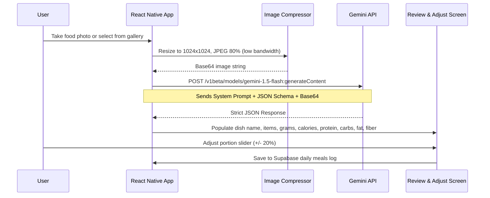

# AI Food Scanner & Nutrition Pipeline

**Engine:** Google Gemini 1.5 Flash (`gemini-1.5-flash`)  
**Format:** Multimodal (Image Base64 + System Instruction + JSON Schema)  
**Cost:** \$0 (Under free-tier quota of 15 Requests Per Minute / 1,500 Requests Per Day)  

---

## 1. Vision Analysis Workflow



---

## 2. Gemini System Prompt & Instructions

```text
You are a certified sports nutritionist and precision food analysis assistant for FitPulse.
Analyze the provided food image carefully:

1. Identify all visible food items, main ingredients, and cooking methods (e.g. grilled, fried, steamed).
2. Estimate the realistic total serving weight in grams based on visual scale cues (plate size, utensils, standard portions).
3. Calculate accurate macronutrients and dietary fiber for the estimated serving:
   - Calories (kcal)
   - Protein (grams)
   - Total Carbohydrates (grams)
   - Total Fat (grams)
   - Dietary Fiber (grams)
4. Break down each detected component with its individual portion weight.
5. Provide a confidence assessment: "high" (clear standard dish), "medium" (mixed dish with uncertain hidden oils/fillings), or "low" (obscured or ambiguous).
6. Always return valid JSON conforming to the requested schema. No conversational filler.
```

---

## 3. JSON Output Schema

```json
{
  "$schema": "http://json-schema.org/draft-07/schema#",
  "title": "FoodNutritionEstimate",
  "type": "object",
  "properties": {
    "dish_name": { "type": "string", "description": "Concise name of the primary dish" },
    "estimated_weight_g": { "type": "number", "description": "Total weight in grams" },
    "calories": { "type": "integer", "description": "Total calories in kcal" },
    "protein_g": { "type": "number", "description": "Protein in grams" },
    "carbs_g": { "type": "number", "description": "Carbohydrates in grams" },
    "fat_g": { "type": "number", "description": "Total fat in grams" },
    "fiber_g": { "type": "number", "description": "Dietary fiber in grams" },
    "confidence": { "type": "string", "enum": ["high", "medium", "low"] },
    "health_tips": { "type": "string", "description": "Quick 1-sentence tip on meal balance" },
    "ingredients": {
      "type": "array",
      "items": {
        "type": "object",
        "properties": {
          "name": { "type": "string" },
          "weight_g": { "type": "number" },
          "calories": { "type": "integer" }
        },
        "required": ["name", "weight_g", "calories"]
      }
    }
  },
  "required": ["dish_name", "estimated_weight_g", "calories", "protein_g", "carbs_g", "fat_g", "confidence"]
}
```

---

## 4. Example Output

```json
{
  "dish_name": "Grilled Chicken Breast with Brown Rice & Broccoli",
  "estimated_weight_g": 380,
  "calories": 520,
  "protein_g": 48.5,
  "carbs_g": 52.0,
  "fat_g": 9.2,
  "fiber_g": 6.8,
  "confidence": "high",
  "health_tips": "Excellent high-protein, clean carbohydrate source for muscle recovery.",
  "ingredients": [
    { "name": "Grilled Chicken Breast", "weight_g": 180, "calories": 297 },
    { "name": "Steamed Brown Rice", "weight_g": 130, "calories": 160 },
    { "name": "Steamed Broccoli Florets", "weight_g": 70, "calories": 25 },
    { "name": "Olive Oil (cooking glaze)", "weight_g": 5, "calories": 38 }
  ]
}
```

---

## 5. Client Portion Adjustment Formula

When the user modifies the portion slider from $W_{orig}$ to $W_{new}$:

$$\text{Scale Factor } (S) = \frac{W_{new}}{W_{orig}}$$

$$\text{Calories}_{new} = \text{round}(\text{Calories}_{orig} \times S)$$
$$\text{Protein}_{new} = \text{round}(\text{Protein}_{orig} \times S, 1)$$
$$\text{Carbs}_{new} = \text{round}(\text{Carbs}_{orig} \times S, 1)$$
$$\text{Fat}_{new} = \text{round}(\text{Fat}_{orig} \times S, 1)$$
$$\text{Fiber}_{new} = \text{round}(\text{Fiber}_{orig} \times S, 1)$$
