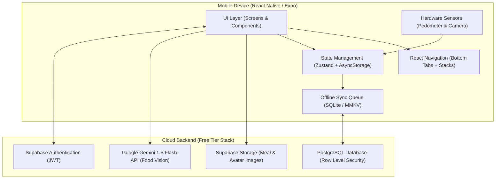
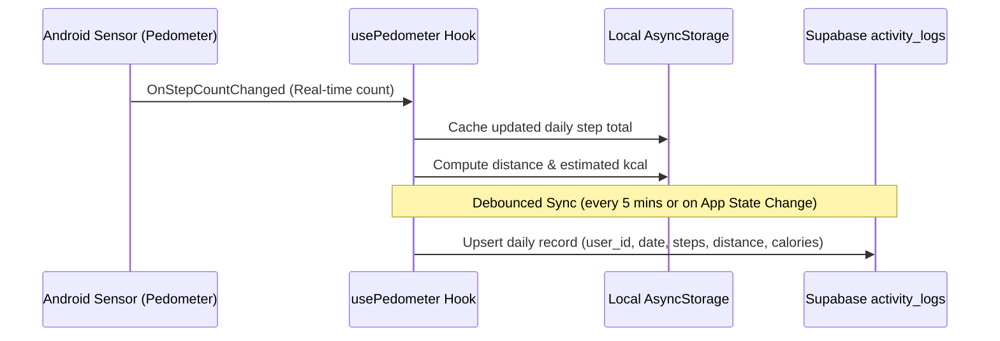
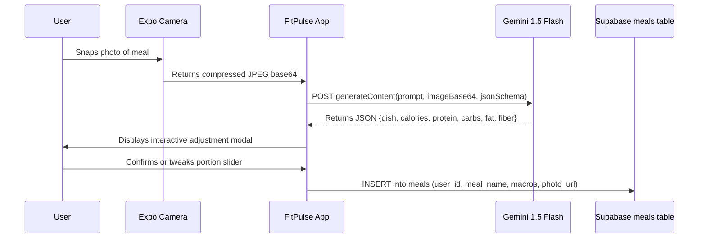

# FitPulse Mobile Application - Technical Architecture

**Platform:** React Native (Expo Managed Workflow)  
**Language:** TypeScript  
**Backend:** Supabase (PostgreSQL, Auth, Storage, Realtime)  
**AI Vision:** Google Gemini 1.5 Flash (Multimodal API)  

---

## 1. System Architecture Overview



---

## 2. Technology Stack Rationale

### 2.1 Why React Native + Expo?
1. **Single Codebase for Both Platforms:** 100% code reuse for Android (primary target) and iOS (future release).
2. **Instant Physical Device Testing:** Both developers can scan an Expo QR code to test on real Android devices immediately via `Expo Go`, without configuring Android Studio SDK emulators or needing macOS.
3. **Hardware Access:** Robust managed libraries:
   - `expo-sensors`: Native pedometer access without complex Android native bridging.
   - `expo-camera` / `expo-image-picker`: Fast photo capture for the AI food scanner.
   - `expo-haptics`: Tactile feedback on workout timers and likes.
4. **Zero Licensing Costs:** Open-source MIT ecosystem.

### 2.2 Why Supabase for Backend?
1. **Built-in Postgres with Row Level Security (RLS):** Allows writing secure database rules directly in SQL so the mobile client can query the database securely without having to build and host a separate custom Node/Express backend server.
2. **Generous Free Tier:**
   - 50,000 monthly active users (MAU).
   - 500 MB database storage (ample for 100k+ step and meal log records).
   - 1 GB file storage (for meal photos and avatars).
   - Realtime websocket subscriptions for live community feeds and leaderboard ranks.

### 2.3 Why Google Gemini 1.5 Flash for Food Vision?
1. **Multimodal Native:** Accepts image base64 + structured prompt in a single API call.
2. **Structured Output (JSON Schema):** Directly returns formatted JSON matching our TypeScript `FoodNutritionEstimate` type.
3. **Free Tier:** 15 requests per minute (RPM) and 1,500 requests per day at zero cost.

---

## 3. Mobile Directory Architecture

```text
src/
├── api/                       # Network clients & endpoints
│   ├── client.ts              # Fetch wrapper with interceptors
│   ├── gemini.ts              # Gemini 1.5 Flash Vision API client
│   └── supabase.ts            # Supabase JS client with AsyncStorage session persistence
├── components/                # Modular reusable UI widgets
│   ├── common/
│   │   ├── Button.tsx
│   │   ├── Card.tsx
│   │   ├── Header.tsx
│   │   └── Badge.tsx
│   ├── dashboard/
│   │   ├── StepRing.tsx       # Circular SVG progress indicator
│   │   ├── MacroBar.tsx       # Stacked Carbs/Protein/Fat bar
│   │   └── StreakBadge.tsx    # Daily streak flame indicator
│   ├── nutrition/
│   │   ├── FoodItemCard.tsx
│   │   └── PortionSlider.tsx  # Interactive weight correction
│   └── workouts/
│       ├── ExerciseCard.tsx
│       └── RestTimer.tsx      # Countdown timer with audio chime
├── hooks/                     # Custom React hooks
│   ├── useAuth.ts             # User session, login, signup
│   ├── usePedometer.ts        # Live step subscription & historical sync
│   ├── useNutrition.ts        # Daily calorie & macro state
│   └── useWorkouts.ts         # Active workout state & timer
├── navigation/                # Navigation controllers
│   ├── RootNavigator.tsx      # Auth vs. Main App switch
│   └── BottomTabNavigator.tsx # 5 core app tabs
├── screens/                   # Full-screen view components
│   ├── DashboardScreen.tsx    # Unified health center
│   ├── ActivityTrackerScreen.tsx # Steps, distance, leaderboard
│   ├── FoodScannerScreen.tsx  # Camera & AI analysis review
│   ├── WorkoutScreen.tsx      # Home workout library & active player
│   └── CommunityScreen.tsx    # Social feed, challenges, posts
├── theme/                     # Design tokens & color palettes
│   ├── colors.ts
│   ├── typography.ts
│   └── spacing.ts
└── types/                     # Shared TypeScript interfaces
    ├── nutrition.ts
    ├── activity.ts
    ├── workout.ts
    └── community.ts
```

---

## 4. Key Subsystem Implementation Designs

### 4.1 Step Tracking Pipeline


### 4.2 AI Food Recognition Pipeline


---

## 5. Security & Offline Resilience

1. **API Keys Protection:** API keys stored in `.env` and accessed via `expo-constants`. For production builds, Gemini calls can be routed through a Supabase Edge Function to avoid client-side API key exposure.
2. **Offline Mode:**
   - Step counts and completed workouts are written to `AsyncStorage` immediately.
   - When offline, network calls are appended to an `offlineQueue`.
   - On `NetInfo` connection restoration, queue is flushed with idempotent `upsert` queries.
3. **Data Protection:** All personal health records adhere to HIPAA/GDPR best practices (encrypted in transit via TLS 1.3, encrypted at rest in PostgreSQL, user deletion endpoint supported).
