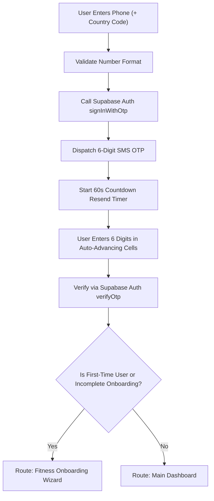

# AVFIT (Vyalwin) — Phone Auth, Fitness Onboarding & Achievement Engine Specification

## 1. System Overview

This specification details the technical architecture and mobile user experience implemented for **AVFIT** (Vyalwin), covering three core pillars:
1. **Phone Number Authentication (Login & Signup via SMS OTP)**
2. **Personalized Fitness Profile & Multi-Step Onboarding**
3. **Gamified Achievements, Trophies & Milestone System**

Built using **React Native (TypeScript, Expo SDK 51)**, **Supabase Auth & PostgreSQL**, and the established **Warm Cream / Forest Green editorial design system**.

---

## 2. Phone Number Authentication Architecture

### 2.1 Workflow Diagram



### 2.2 Key Security & Anti-Abuse Measures
- **SMS Rate Limiting**: Enforces a strict 60-second cooldown between resend requests.
- **Client-Side Secret Shielding**: No OTP tokens or database secrets are logged or stored in local device caches.
- **Consent Banner**: Clear authorization notice displayed prior to dispatching SMS: *"By proceeding, you agree to receive SMS verification codes. Standard carrier rates may apply."*
- **Auto-Advancing Cells**: 6 individual text input cells that automatically advance on keystroke and backspace smoothly.

---

## 3. Fitness Profile & Scientific Onboarding Engine

### 3.1 BMR & TDEE Scientific Calculations (Mifflin-St Jeor)

The application calculates energy expenditure using the clinically validated **Mifflin-St Jeor** formula:

$$\text{BMR}_{\text{male}} = (10 \times \text{weight}_{\text{kg}}) + (6.25 \times \text{height}_{\text{cm}}) - (5 \times \text{age}) + 5$$

$$\text{BMR}_{\text{female}} = (10 \times \text{weight}_{\text{kg}}) + (6.25 \times \text{height}_{\text{cm}}) - (5 \times \text{age}) - 161$$

$$\text{BMR}_{\text{other}} = (10 \times \text{weight}_{\text{kg}}) + (6.25 \times \text{height}_{\text{cm}}) - (5 \times \text{age}) - 78$$

### 3.2 Total Daily Energy Expenditure (TDEE) Multipliers

| Activity Level | Multiplier | Description |
| :--- | :---: | :--- |
| **Sedentary** | `1.200` | Little or no structured exercise (desk job) |
| **Lightly Active** | `1.375` | Light exercise 1–3 days per week |
| **Moderately Active** | `1.550` | Moderate training 3–5 days per week |
| **Very Active** | `1.725` | Heavy training 6–7 days per week |

### 3.3 Goal-Specific Target Offsets & Macronutrient Split
- **Weight Loss**: $\text{TDEE} - 500\text{ kcal}$ (with safe biological floor of $1,200\text{ kcal}$ for females, $1,500\text{ kcal}$ for males).
- **Muscle Gain**: $\text{TDEE} + 350\text{ kcal}$ (lean bulk surplus).
- **Maintenance / General**: Equal to TDEE.
- **Macronutrients**:
  - **Protein**: $2.0\text{g} \times \text{weight}_{\text{kg}}$ ($4\text{ kcal/g}$) for muscle sparing during deficit & hypertrophy.
  - **Fats**: $25\%$ of total calories ($9\text{ kcal/g}$) for hormonal health.
  - **Carbohydrates**: Remaining calories divided by $4\text{ kcal/g}$.
- **Hydration**: $35\text{ ml} \times \text{weight}_{\text{kg}} + 500\text{ ml}$ activity allowance.

> [!IMPORTANT]
> **Medical Disclaimer Display**: All calculated targets are presented with an explicit disclaimer: *"Calorie and nutrition targets are algorithmic estimates for general fitness guidance, not clinical or medical advice. Always consult a healthcare provider or registered dietitian before beginning restrictive diets."*

---

## 4. Gamified Achievements, Trophies & Milestone System

### 4.1 Trophy Hierarchy & Point Values

| Trophy Tier | Color Code | Community Points | Purpose |
| :--- | :---: | :---: | :--- |
| **Bronze** | `#CD7F32` | 25 – 75 pts | First steps, initial logs, and beginner milestones |
| **Silver** | `#94A3B8` | 100 – 200 pts | Consistency, 7-day streaks, and habitual commitment |
| **Gold** | `#EAB308` | 300 – 450 pts | Significant accomplishments (30-day streak, 50km) |
| **Platinum** | `#0284C7` | 500 – 600 pts | Advanced fitness mastery (100 workouts, goal reached) |
| **Diamond** | `#BE185D` | 1,000 pts | Apex long-term status (1,000+ points and comprehensive mastery) |

### 4.2 25 Standard Achievement Catalog

```
Category A: Step & Activity
├── STEPS_FIRST_1K     (Bronze)  - Log first 1,000 daily steps
├── STEPS_5K           (Bronze)  - Reach 5,000 daily steps
├── STEPS_10K          (Silver)  - Reach 10,000 daily steps
├── STREAK_7           (Silver)  - 7-day continuous movement streak
├── STREAK_30          (Gold)    - 30-day unstoppable activity streak
└── DISTANCE_50KM      (Gold)    - 50 cumulative kilometers on foot

Category B: Workout Routines
├── WORKOUT_FIRST      (Bronze)  - Complete 1st guided workout
├── WORKOUT_5          (Bronze)  - Complete 5 workouts
├── WORKOUT_25         (Silver)  - Complete 25 workouts
├── WORKOUT_WEEKLY     (Silver)  - 4 workouts in one calendar week
├── WORKOUT_MONTHLY    (Gold)    - 16 workouts in one calendar month
└── WORKOUT_100        (Platinum)- 100 completed workout sessions

Category C: AI Food & Nutrition
├── NUTRITION_FIRST_LOG(Bronze)  - Scan and log 1st meal with AI scanner
├── NUTRITION_7_DAYS   (Silver)  - Food log for 7 consecutive days
├── NUTRITION_MACRO_HIT(Silver)  - Hit protein and calorie goals 5 days
└── NUTRITION_30_DAYS  (Gold)    - Consistent food logging for 30 days

Category D: Community & Social
├── COMMUNITY_FIRST_POST (Bronze) - Share 1st workout/meal update
├── COMMUNITY_JOIN_CHALL (Bronze) - Join 1st fitness leaderboard challenge
├── COMMUNITY_MOTIVATOR  (Silver) - Like/encourage 20 member updates
└── COMMUNITY_COMPLETE   (Gold)   - Complete 50km community challenge

Category E: Personal Mastery & Apex
├── PROGRESS_UPDATE    (Bronze)  - Log a body metric check-in
├── PROGRESS_GOAL      (Platinum)- Reach target weight or strength goal
└── PROGRESS_DIAMOND   (Diamond) - 1,000 community points & 50+ workouts
```

### 4.3 Anti-Cheat & Idempotency Rules
1. **Server Validation**: Evaluated either through PostgreSQL triggers or trusted backend functions (`evaluate_user_milestones()`).
2. **Idempotent Unlocking**: Milestones check `is_unlocked = FALSE` before writing unlock timestamps; trophies cannot be awarded twice.
3. **Delta Checking**: Step counts and workout logs must pass reasonable human thresholds (e.g. step frequency and timestamp sequencing).

---

## 5. File Manifest & Architecture Map

| File Path | Description |
| :--- | :--- |
| `src/types/index.ts` | Complete TypeScript models for Auth, Fitness Profile, and Achievements |
| `src/services/auth.ts` | Supabase Phone OTP auth service, sandbox mode, session persistence |
| `src/services/fitnessProfile.ts` | Mifflin-St Jeor engine, BMR/TDEE calculations, macro generator |
| `src/services/achievements.ts` | 25-trophy catalog, anti-cheat evaluator, summary aggregator |
| `src/screens/auth/PhoneAuthScreen.tsx` | Phone entry with country selector, validation, and consent banner |
| `src/screens/auth/OtpVerificationScreen.tsx` | 6-digit OTP cells with 60s countdown timer and resend logic |
| `src/screens/onboarding/FitnessOnboardingScreen.tsx` | 4-step guided onboarding wizard with real-time target preview |
| `src/screens/achievements/AchievementsScreen.tsx` | Gamified Trophy Room with category filters, tier badges, and share actions |
| `src/components/achievements/TrophyUnlockModal.tsx` | Celebratory unlock modal with tier badge and points celebration |
| `src/screens/profile/ProfileEditScreen.tsx` | View and edit personal metrics and fitness profile anytime |
| `src/screens/DashboardScreen.tsx` | Dashboard displaying personalized Mifflin-St Jeor targets & trophy card |
| `src/navigation/RootNavigator.tsx` | Native Stack + Bottom Tabs integrating all auth, onboarding, and trophy screens |
| `docs/DATABASE_SCHEMA.sql` | Production PostgreSQL schema with RLS policies, triggers, and seed data |
| `docs/mobile_emulator.html` | Interactive web-based mobile emulator reflecting all new screens |
