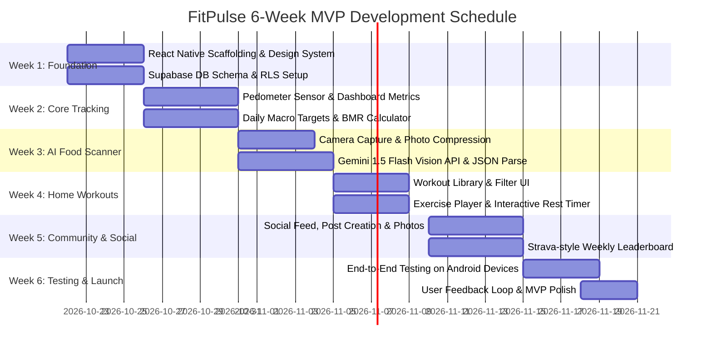

# 2-Developer Agile Roadmap & MVP Execution Plan

**Team Composition:** 2 Full-Stack Mobile Engineers  
**Target Delivery:** 6 Weeks to Working Alpha on Android (Expo Go)  
**Budget:** \$0 Operational Spend (Free Tiers: Expo, Supabase, Gemini API)  

---

## 1. Developer Role Division

| Area | Developer 1 (Frontend & UX Lead) | Developer 2 (Backend & AI Lead) |
|---|---|---|
| **Primary Domain** | React Native UI, Animations, Sensors, Navigation | Supabase DB, Gemini AI Vision, State & Auth |
| **Pillar 1 (Dashboard)** | Circular SVG rings, Macro bar, Layouts | Metric aggregation queries, Streak algorithm |
| **Pillar 2 (Steps)** | `expo-sensors` Pedometer listener & UI | Supabase sync queue, Weekly leaderboard views |
| **Pillar 3 (AI Food)** | Camera viewfinder, Photo picker, Adjustment UI | Gemini API integration, JSON parser, Food DB |
| **Pillar 4 (Workouts)** | Workout player, Rest countdown timer, Audio | Workout catalog data, Completion logging |
| **Pillar 5 (Community)**| Social feed layout, Like animations, Post modal | Supabase Realtime feed, Likes/Comments tables |

---

## 2. 6-Week Milestone Plan

---

## 3. Sprint Breakdown

### Sprint 1 (Week 1): Foundation & Architecture
- **Deliverables:**
  - Setup React Native Expo project with TypeScript, React Navigation, and Lucide icons.
  - Setup Supabase instance, execute `DATABASE_SCHEMA.sql`, configure Auth.
  - Establish color theme tokens, reusable Cards, Buttons, and Header components.

### Sprint 2 (Week 2): Unified Dashboard & Step Tracking
- **Deliverables:**
  - Build `DashboardScreen` with interactive rings for steps, calories, and macros.
  - Connect `expo-sensors` Pedometer to track live physical steps on Android.
  - Implement BMR/TDEE formula for personalized calorie targets.

### Sprint 3 (Week 3): AI Food Scanner & Nutrition Calculator
- **Deliverables:**
  - Build `FoodScannerScreen` with `expo-camera`.
  - Connect Gemini 1.5 Flash multimodal vision API.
  - Implement the portion adjustment slider and save to Supabase `meals` table.

### Sprint 4 (Week 4): Home Workout Engine
- **Deliverables:**
  - Build `WorkoutScreen` with bodyweight exercise routines.
  - Build guided active workout player with animated exercise instructions and rest timer countdown.
  - Log finished workouts to `workout_logs` and calculate calorie expenditure.

### Sprint 5 (Week 5): Fitness Community & Social Feed
- **Deliverables:**
  - Build `CommunityScreen` with feed stream, high-fives (likes), and comment bottom sheets.
  - Build weekly friend and community step leaderboard.
  - Implement post creation modal with photo upload to Supabase Storage.

### Sprint 6 (Week 6): Real-User Testing & Android Deployment
- **Deliverables:**
  - Test on 10+ real beta users using Expo Go on Android.
  - Validate AI nutrition scanning accuracy across varied meals.
  - Ensure zero battery drain from pedometer background listeners.
  - Prepare Google Play Store listing assets.
