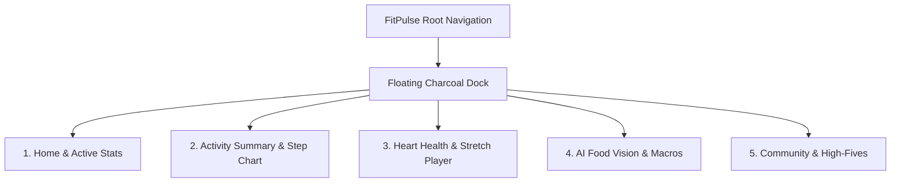

# FitPulse UI/UX Design Specification (Bespoke Editorial & Organic Fitness)

**Design Inspiration:** Modern Botanical Luxury & Warm Editorial Fitness  
**Core Reference:** Warm Oatmeal/Cream Backgrounds, Deep Forest Green Accents, Terracotta Orange Highlights, and Floating Dark Charcoal Dock Navigation.

---

## 1. Visual Design Tokens & Palette

| Token | Hex Value | Role in UI |
|---|---|---|
| **Canvas Background** | `#F9F6F0` | Warm Oatmeal / Organic Cream canvas across all screens |
| **Card Surface (White)** | `#FFFFFF` | Primary elevated card surface with soft borders |
| **Card Surface (Warm)** | `#F3EDE2` | Secondary warm cream cards (Hero card, Active Stats) |
| **Primary Accent (Forest Green)**| `#244A32` | Brand identity, bar chart fills, play buttons, active icons |
| **Accent Orange (Terracotta)** | `#EB7142` | Highlighted Wednesday step bar, active streak pill (`🔥 11`) |
| **Soft Sage Tint** | `#E8F1EC` | 10% forest green tint for badge pills and complete tags |
| **Muted Cream Divider** | `#DFD5C2` | Vertical metric dividers and subtle separators |
| **Floating Dock Background** | `#161A17` | Floating dark charcoal bottom pill dock |
| **Dock Active Badge** | `#FFFFFF` | Circular white pill badge holding active tab icon |
| **Typography Primary** | `#191C1A` | Deep charcoal for crisp, high-contrast readability |
| **Typography Secondary** | `#6B726C` | Warm sage grey for timestamps, metrics, and captions |

---

## 2. Layout & Key Screen Architecture



### Screen 1: Home & Hero Screen
- **Top Row:**
  - Left: User avatar circle with subtle organic ring (`44x44px`)
  - Center/Right: Calorie burn pill `(^) 124 kcal` with green circular badge
  - Far Right: Circular action button `⚡`
- **Greeting Section:**
  - Large display headline: `Hey, Michelle` (or `Hey, Alex`)
  - Subtitle: `Welcome, 11-week. Keep keep going!`
  - Right: Floating warm terracotta streak pill `🔥 11`
- **Hero Centerpiece:**
  - Warm beige card (`#F3EDE2`) with botanical foliage accents, athlete silhouette, and `Target 85% Reached` badge.
- **Active Stats Floating Card:**
  - Background: Warm cream (`#F7F2EA`) with soft border.
  - Header: `⚡ Active Stats` with mini circular `+` button.
  - Left Column: `450 kcal` (Duration).
  - Divider: 1px warm grey vertical separator.
  - Right Column: `72 min` (Workouts).
- **Today's Goals List:**
  - Goal cards with rounded corners (`20px`), icon badges, titles, and `Complete` pill.

### Screen 2: Activity Summary & Walking Steps
- **Title:** `Activity Summary`
- **Walking Steps Card:**
  - Header: `Walking steps` with `Week` pill toggle.
  - Bar Graph:
    - `Sun`: `8,328` (Forest green bar)
    - `Mon`: `10,032` (Tallest Forest green bar)
    - `Tue`: `8,211` (Forest green bar)
    - `Wed`: Highlighted with dark charcoal tooltip `7,427` and vibrant terracotta/orange textured bar.
    - `Thr` & `Fri`: Soft cream dashed pending bars.
- **Two-Column Stats Grid:**
  - **Left Card (Sets):** Dumbbell icon in mint badge, `7,3k Duration`, category pills (`Run`, `Gym`, `Walk`, `+`).
  - **Right Card (Heart Rate):** Watch icon in peach badge, `139 bpm Min • 128-162`, `⌚ Device: Apple Watch...` pill.
- **Today's Goals Section:**
  - Trophy header with `+` action button.
  - Goal list items (Gym Workout - Complete).

### Screen 3: Heart Health & Stretch Routine
- **Top Bar:** Circular back button `<` and `Day | Week` pill toggle (active option is solid forest green).
- **Title:** `Heart Health`
- **Metric Badges:**
  - `Stretch: 78%` (lilac badge)
  - `Endurance: 64%` (cyan badge)
  - `Stability: 71%` (warm cream badge)
- **Hero Centerpiece:**
  - Botanical organic heart artwork wrapped in vines and leaves with carousel navigation `<` and `>`.
- **Sleep Time Card:**
  - `7h30m last night` with cloud and moon illustration, plus 7-day circular checkmarks.
- **Performing Stretch Routine:**
  - 3D yoga pose graphic, `Hold stretch for 20-30 minutes per day`, live countdown timer, and circular forest green play button `▶`.

---

## 3. Floating Bottom Navigation Dock Specification

```text
+-----------------------------------------------------------+
|                          Screen Content                   |
|                                                           |
|       +---------------------------------------------+     |
|       |   ( Home )   👟      📸       🫀       👥    |     |
|       |  [O Active]                                 |     |
|       +---------------------------------------------+     |
|                       Home Indicator                      |
+-----------------------------------------------------------+
```
- **Shape:** Rounded pill dock (`borderRadius: 36px`, floating `16px` above bottom edge).
- **Color:** Deep Charcoal `#161A17` with subtle shadow (`shadowRadius: 10px`).
- **Active Tab Indicator:** White circular disc (`44x44px`) with dark forest green icon centered.
- **Inactive Tabs:** Subtle sage grey icons (`#6F7771`).
